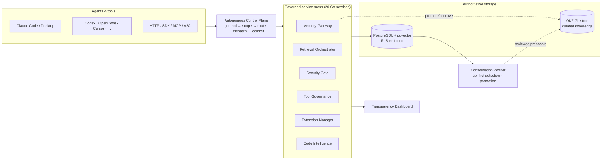

# SCOS Memory Fabric

**A governed, crash-resilient, model-neutral memory substrate for AI agents.**

One durable memory plane in front of every agent, IDE, and CLI you run — instead of a
different half-remembered context per tool. PostgreSQL is authoritative, every turn is
journaled, and nothing becomes trusted long-term knowledge without passing through an
explicit promotion and review path.

[](LICENSE)
[](go.mod)
[](https://github.com/dylmarriner/scos-memory/actions/workflows/ci.yml)
[](CONTRIBUTING.md)

[Architecture](#architecture) · [Quick start](#quick-start) · [Technical highlights](#technical-highlights) · [Repository map](#repository-map) · [Contributing](#contributing)

---

## Why this exists

Most "AI memory" projects collapse two very different jobs into one vector database:
*remembering everything that happened* and *deciding what's actually true and durable*.
That produces systems that are either forgetful or confidently wrong.

SCOS Memory Fabric keeps those jobs separate:

> **Persist every interaction. Promote only durable knowledge.**

Every accepted message, tool call, and state transition is durably recorded and
recoverable after a crash. Nothing is promoted into trusted long-term memory —
and nothing an agent writes can mutate authoritative shared knowledge — without
going through an explicit, evidenced, reviewable promotion path. Search indexes
and embeddings are treated as derived, rebuildable artifacts; PostgreSQL and the
OKF Git store are the sources of truth.

The full normative specification lives in [`GOVERNANCE.md`](GOVERNANCE.md) — a
113 KB, RFC‑2119-style governing blueprint that every service is audited against
(`make audit`). This README is the map; `GOVERNANCE.md` is the law.

## Architecture

Every supported request enters through one **Autonomous Cognitive Control Plane**.
Agents are workers inside that lifecycle — they are never responsible for
remembering to call memory themselves.



**How it fits together:**

- **Autonomous Control Plane** — intercepts every request, journals it, resolves scope,
  hydrates context from memory and code intelligence, selects and coordinates the
  services and tools needed, dispatches the agent, then commits the response and
  checkpoint. See [ADR 0002](docs/adr/0002-autonomous-control-plane.md).
- **Governed service mesh** — 20 independently testable Go HTTP services (memory
  gateway, retrieval orchestrator, security gate, tool governance, extension manager,
  code intelligence, backup manager, recovery orchestrator, and more), each with its
  own health/readiness endpoints and row-level-security-scoped access to Postgres.
- **PostgreSQL is authoritative.** Hybrid retrieval combines full-text search and
  `pgvector` embeddings; embeddings and search indexes are rebuildable derivatives,
  never the source of truth.
- **OKF (Open Knowledge Fabric)** is the authoritative store for curated, approved,
  portable knowledge, versioned in Git — separate from the raw conversational record.
- **Consolidation worker** (Python) turns durable candidates into reviewed promotion
  proposals, including conflict detection and an optional LLM-assisted synthesis pass
  with a deterministic fallback when no model key is configured.
- **Transparency dashboard** — a permission-aware, real-time view into memory links,
  routing decisions, token flow, agents, tools, and recovery activity.

## Technical highlights

- **20 governed Go services, ~32,000 LOC, 483 tests** — see the auto-generated
  [`indexes/CODE_INDEX.md`](indexes/CODE_INDEX.md) (regenerate with `make code-index`;
  it records what exists, not whether it satisfies governance).
- **Row-level security on every data-plane table** — 10 RLS policy files enforce
  tenant/agent isolation at the database layer, not just in application code.
- **20 sequential, reviewed SQL migrations** — append-only authoritative history,
  no destructive schema drift.
- **10 Architecture Decision Records** — every non-obvious design choice (routing
  policy, extension signing/isolation, context-compression profiles, rewrite policy)
  is written down before it's built. See [`docs/adr/`](docs/adr/).
- **A real failure-injection suite, not a mock** — 58 cases run against the live
  Compose stack over HTTP, kill and restart services mid-flight, and assert
  idempotency directly against PostgreSQL. `make failure-injection` fails closed
  if the stack isn't actually running — there is no synthetic pass path.
- **Zero-secret-default deployment** — the base Compose file ships with no default
  bearer tokens, issuer secrets, or database passwords; startup fails until they're
  provided. See [`docs/security-configuration.md`](docs/security-configuration.md).
- **Governance as a build gate, not a document** — `make audit` runs
  [`scripts/audit_governance.py`](scripts/audit_governance.py) against the running
  system and fails closed when required services, interfaces, persistence
  boundaries, or test evidence are missing.
- **One bridge, nine agent runtimes** — Claude Code, Claude Desktop, Codex CLI,
  Hermes Agent, Cursor, Windsurf, Cline, Continue, OpenCode, Antigravity, Kilo,
  OpenClaw, and Qwen Code all connect through the same governed MCP surface. See
  [`integrations/`](integrations/).
- **Production-hardened service core** — structured JSON logging, panic-recovery
  middleware, and graceful shutdown (draining in-flight requests on SIGTERM) live
  in shared [`packages/httpmid`](packages/httpmid/) and
  [`packages/tlsserve`](packages/tlsserve/), rolled out to the request-critical
  services first (memory gateway, security gate, autonomous control plane).
- **Supply-chain scanning in CI** — Go and Python dependency vulnerability
  scanning, container image scanning (Trivy, uploaded to the GitHub Security
  tab), secret scanning (gitleaks), and a generated CycloneDX SBOM on every
  push. See [`.github/workflows/ci.yml`](.github/workflows/ci.yml).

## Quick start

Requires Docker, Docker Compose, and `openssl`. Prefer to run without a
container runtime? See [`deploy/native/README.md`](deploy/native/README.md)
for the equivalent systemd + native PostgreSQL path — same services, same
config surface, no Docker.

```bash
git clone https://github.com/dylmarriner/scos-memory.git
cd scos-memory

cp .env.example .env
# Set SCOS_INTERNAL_SERVICE_TOKEN, SCOS_CONTROL_PLANE_TOKEN, and
# SCOS_SECURITY_ISSUER_SECRET with: openssl rand -base64 32
# Set POSTGRES_PASSWORD, SCOS_DATABASE_URL (sslmode=require or stronger),
# and either SCOS_AGENT_ENDPOINT or DEEPSEEK_API_KEY. When using DeepSeek,
# set DEEPSEEK_MODEL=deepseek-v4-flash and leave SCOS_AGENT_ENDPOINT empty.
${EDITOR:-vi} .env

set -a; . ./.env; set +a
docker compose -f deploy/compose/docker-compose.yml config >/dev/null
docker compose -f deploy/compose/docker-compose.yml up --build
```

Verify it's alive:

```bash
curl http://localhost:8080/health/live
curl http://localhost:8080/health/ready
curl http://localhost:8080/v1/version
```

Then run the local checks:

```bash
make fmt        # gofmt + Python compileall
make test       # go test ./... + Python unit tests + failure-injection unit runner
make validate   # JSON Schema + Compose config validation
make audit      # governance compliance gate
```

Full failure-injection acceptance run (58 cases, requires the live Compose stack):

```bash
make failure-injection
```

## Repository map

```text
services/       20 governed Go HTTP services (memory-gateway, retrieval-orchestrator,
                 security-gate, autonomous-control-plane, extension-manager, …)
packages/       Shared Go/TS libraries (auth, database, telemetry, SDKs, llmclient)
workers/        Python workers (consolidation, index-maintenance, policy-evaluation)
adapters/       Runtime boundary adapters (HTTP, MCP, CLI wrapper, model proxy, Hermes)
integrations/   Per-agent plugin bundles (Claude, Codex, OpenCode, Cursor, …)
database/       Authoritative SQL migrations, RLS policies, integration tests
schemas/        JSON Schema contracts (events, memory candidates, handoffs, routing)
api/            OpenAPI contract + contract coverage tests
okf/            Approved, portable, curated knowledge (Git-authoritative)
docs/           ADRs, runbooks, security configuration, agent connection guide
dashboard/      Browser client for the transparency projection
deploy/         Compose stack, Dockerfile, native systemd deployment (deploy/native/)
tests/          Failure-injection runner, stress tests, cross-cutting test suites
GOVERNANCE.md   The normative specification every service is audited against
```

## Development order

The system is built and audited in dependency order:

1. Durable sessions, turns, messages, chunks and events.
2. Transactional checkpoints and outbox processing.
3. Namespaces, policies, memory versions and evidence.
4. Hybrid retrieval using PostgreSQL full-text search and pgvector.
5. Consolidation, conflict detection and review.
6. OKF import/export and protected approval workflow.
7. MCP and A2A adapters.
8. Recovery, backup and failure-injection hardening.

Read [`GOVERNANCE.md`](GOVERNANCE.md) before changing architecture. Future-us has
enough problems without present-us inventing incompatible persistence paths.

## Security

Deployment has no secret defaults — see
[`docs/security-configuration.md`](docs/security-configuration.md) for the full
threat-relevant configuration surface (bearer tokens, control-plane tokens, TLS
modes, RLS boundaries). See [`docs/security/threat-model.md`](docs/security/threat-model.md)
for the trust boundaries and mitigations behind that configuration, and
[`docs/security/incident-response.md`](docs/security/incident-response.md) for
the runbook if something goes wrong. To report a vulnerability, see
[`SECURITY.md`](SECURITY.md).

## Scaling

The reference deployment is single-host Compose, not a multi-node cluster —
see [`docs/scaling.md`](docs/scaling.md) for what already supports
horizontal scale-out (stateless services, RLS-scoped Postgres access,
graceful shutdown), what doesn't yet (a handful of services with local disk
state), and the reference path to multi-node if it's ever needed.

## Contributing

Issues and PRs are welcome. Start with
[`CONTRIBUTING.md`](CONTRIBUTING.md) for the local setup, coding standards, and
PR checklist, and [`GOVERNANCE.md`](GOVERNANCE.md) for the architectural
constraints changes are audited against.

## License

[MIT](LICENSE) © Dylan Marriner

See [`CHANGELOG.md`](CHANGELOG.md) for release history and
[`CODE_OF_CONDUCT.md`](CODE_OF_CONDUCT.md) for community expectations.
