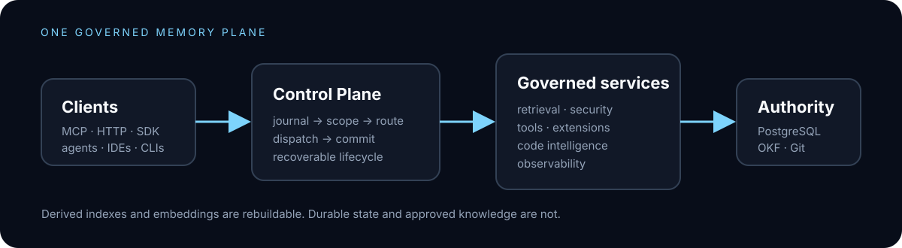

<div align="center">


# SCOS Memory Fabric

### Governed, crash-resilient memory infrastructure for AI agents

One durable memory plane for agents, IDEs, and CLIs. PostgreSQL remains authoritative;
every turn is journaled; durable knowledge is promoted only through an explicit,
reviewable path.

[](LICENSE)
[](go.mod)
[](https://github.com/dylmarriner/scos-memory/actions/workflows/ci.yml)
[](SECURITY.md)

[Quick start](#quick-start) · [Architecture](docs/architecture.md) · [API](api/openapi.yaml) · [Contributing](CONTRIBUTING.md)



</div>

> Status: active engineering repository. Local build, unit-test, structural-audit,
> and deployment paths are present. Production deployment, external integrations,
> and live infrastructure evidence remain environment-dependent; see
> [the current governance audit](docs/governance-audit-current.md).

## What it is

SCOS Memory Fabric separates two jobs that are commonly conflated:

> **Persist every interaction. Promote only durable knowledge.**

The fabric provides a governed lifecycle for agent context: journal the request,
resolve identity and scope, retrieve evidence, coordinate tools, commit the result,
and recover cleanly after failure. Search indexes and embeddings are rebuildable
derivatives. PostgreSQL and the OKF Git store are the authorities.

## Why it exists

Vector search is useful retrieval infrastructure, but it is not an authority model.
Without durable events, scope enforcement, promotion rules, and recovery semantics,
an agent can become very good at remembering the wrong thing. SCOS makes those
boundaries explicit and inspectable.

## Technical highlights

- **Governed service mesh** — independently testable Go HTTP services with health
  and readiness endpoints, shared contracts, and explicit service boundaries.
- **Authoritative persistence** — PostgreSQL stores the durable record; pgvector,
  full-text indexes, and embeddings can be rebuilt.
- **Reviewable knowledge promotion** — consolidation produces evidenced proposals;
  approved knowledge is versioned in the OKF Git store.
- **Crash-aware workflows** — transactional checkpoints, outbox processing,
  idempotency keys, recovery leases, and failure-injection tests cover the paths
  where “it probably worked” is not an acceptable state.
- **Agent-neutral integration** — MCP and runtime adapters connect Claude, Codex,
  OpenCode, Cursor, Hermes, Kilo, OpenClaw, Qwen, and other clients through the
  same governed surface. See [`integrations/`](integrations/).
- **Security-conscious defaults** — deployment secrets are required rather than
  silently invented; tenant isolation is enforced at the data layer where the
  deployment is configured correctly. Read [`SECURITY.md`](SECURITY.md) before
  exposing a service.
- **Governance as a gate** — `make audit` checks the running system against the
  normative [`GOVERNANCE.md`](GOVERNANCE.md), not just against prose.

## Quick start

Requirements: Docker, Docker Compose, Go 1.26+, Python 3.11+, and OpenSSL.

```bash
git clone https://github.com/dylmarriner/scos-memory.git
cd scos-memory
cp .env.example .env
${EDITOR:-vi} .env
set -a; . ./.env; set +a
docker compose -f deploy/compose/docker-compose.yml up --build
```

In a second terminal:

```bash
curl http://localhost:8080/health/live
curl http://localhost:8080/health/ready
curl http://localhost:8080/v1/version
```

The required variables and safe TLS modes are documented in
[`docs/security-configuration.md`](docs/security-configuration.md). For a
non-container deployment, use [`deploy/native/README.md`](deploy/native/README.md).

## Verify the repository

```bash
make fmt       # gofmt and Python compile checks
make test      # Go, Python, schema, and failure-injection unit suites
make validate  # JSON Schema and Compose validation
make audit     # governance compliance gate
```

The full failure-injection run requires a live Compose stack:

```bash
make failure-injection
```

It is intentionally fail-closed when the stack is absent. A local green build is
not a production approval; the audit documents the boundary between source proof,
runtime proof, and deployment-owned proof.

## Architecture

Clients enter through the Autonomous Cognitive Control Plane. The control plane
journals the interaction, resolves scope, hydrates context, selects capabilities,
dispatches work, and commits the response. Governed services perform retrieval,
security, code intelligence, tool policy, extensions, and persistence. Workers
consolidate and index derived data without becoming authorities.

The visual overview above is deliberately small. For component responsibilities,
trust boundaries, and data ownership, read [`docs/architecture.md`](docs/architecture.md).
For the normative design, read [`GOVERNANCE.md`](GOVERNANCE.md). For decisions that
deserve history, see [`docs/adr/`](docs/adr/).

## Repository map

```text
services/       Go HTTP services and control-plane boundaries
packages/       Shared auth, database, contracts, TLS, and telemetry libraries
workers/        Python consolidation, embedding, indexing, and policy workers
adapters/       Runtime boundary adapters
integrations/   Agent and client plugin bundles
database/       Migrations, RLS policies, and database integration tests
schemas/        JSON Schema contracts
okf/            Approved, portable knowledge under Git authority
dashboard/      Transparency projection browser client
docs/           Architecture, ADRs, runbooks, and security guidance
deploy/         Compose and native systemd deployment paths
tests/          Cross-cutting and failure-injection suites
```

## Security and operational boundaries

Read [`docs/security/threat-model.md`](docs/security/threat-model.md) before
deploying. In particular, the reference Compose deployment is single-host,
production PKI and secret management are deployment-owned, and internal bearer
tokens have a deliberately large blast radius. Scaling constraints are documented
in [`docs/scaling.md`](docs/scaling.md), with incident procedures in
[`docs/security/incident-response.md`](docs/security/incident-response.md).

Report vulnerabilities privately through [`SECURITY.md`](SECURITY.md).

## Contributing

Start with [`CONTRIBUTING.md`](CONTRIBUTING.md), then read [`GOVERNANCE.md`](GOVERNANCE.md)
for changes affecting persistence, authority, interfaces, or security boundaries.
Pull requests should include the relevant verification commands and an ADR when a
design decision changes. The issue forms and PR checklist live in [`.github/`](.github/).

## License

[MIT](LICENSE) © Dylan Marriner

See [`CHANGELOG.md`](CHANGELOG.md) for release history and
[`CODE_OF_CONDUCT.md`](CODE_OF_CONDUCT.md) for community expectations.
